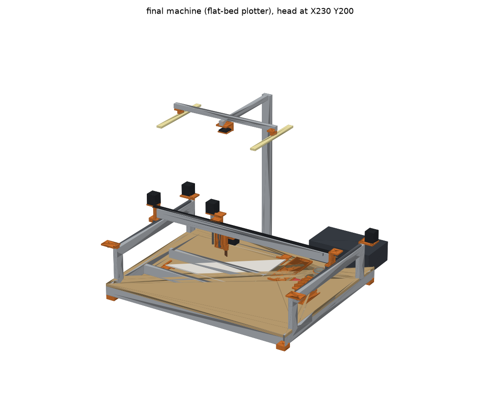
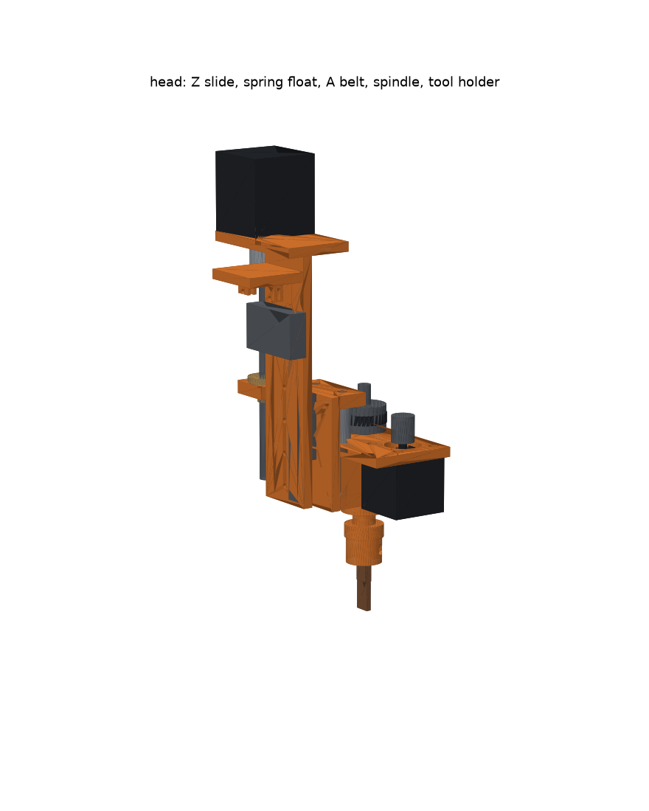
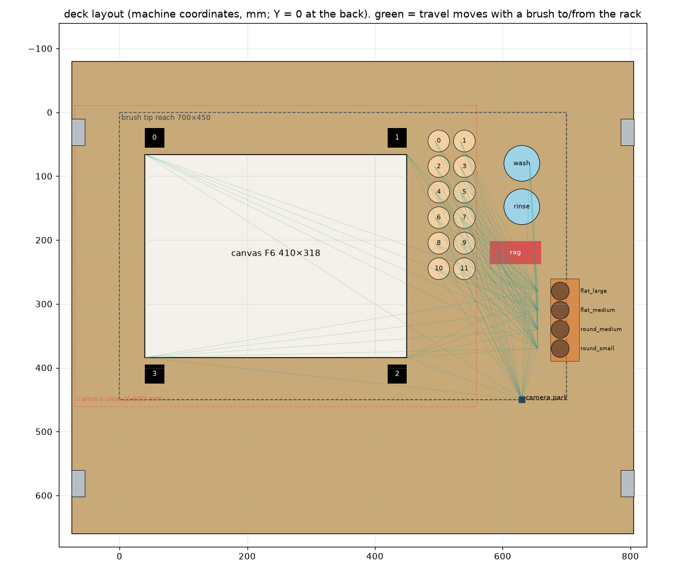

# 完成機（平台プロッタ型）— CAD

`docs/rig_plan.md` §2 の完成機を Python（manifold3d）で作ったもの。キャンバスとステーションは天板に固定し、ガントリーが上を動く。

```bash
uv pip install --python .venv/bin/python -e '.[cad]'
.venv/bin/python machine/cad/machine.py           # STL・組立 GLB・部品表・天板の切り出し図・プレビュー → machine/cad/
.venv/bin/python machine/cad/machine.py --check   # 寸法・干渉チェックだけ（71 項目）
python -m http.server -d machine/cad 8000         # http://127.0.0.1:8000/viewer.html で組立を 3D で見る
```

- **配置は `configs/machine_final.yaml` から読む。** パレット・瓶・布・ラック・キャンバス・作業範囲・カメラの待機位置は、
  ソフト（G-code、デジタルツイン `painter twin`）と同じ値になる。配置を変えるときは yaml を直して、`--check` を通す。
- 機構の寸法は `machine/cad/machine.py` 冒頭の定数。**★ は購入品の代表寸法**なので、買う物が決まったら実測で直す。
- **版（バージョン）**: 印刷部品に `M<VERSION>`（今は **M1**）を刻む（底面、入らなければ上向きの面）。形を変えたら `machine.py` の `VERSION` を上げる（上げ忘れはテストで止まる）。
- 座標は機械座標そのまま（X = 右、Y = 手前、Y = 0 が奥のカメラの柱側、Z = 0 がキャンバス表面、ヘッドは筆先の位置）。



| ヘッド | 天板の配置（緑 = 筆を持ってラックに出入りする移動） |
| --- | --- |
|  |  |

## 構成

| 部分 | 内容 |
| --- | --- |
| フレーム | 下枠 2040（880×740）、柱 ×4、Y 梁 ×2（上に MGN12 550mm）。天板 MDF 12mm |
| X・Y | ベルト駆動（GT2）。Y は左右 2 モーター（Klipper の `stepper_y` / `stepper_y1`、左右のエンドストップで直角を出す） |
| ガントリー | X 梁 2040（862mm）の前面に MGN12 800mm。梁は**ヘッドの手前**にある（待機位置で梁がカメラとキャンバスの間に入らない） |
| Z | MGN9 150mm + T8 送りねじ（リード 2mm）。X キャリッジの下端は z 75（ラックに吊った筆より上） |
| 筆圧 | **フロート**: 主軸・A モーターごと Ø6 シャフト 2 本に乗り、ばね 2 本で下へ押される（予圧 4mm、上へ 10mm 逃げる）。上の耳のマイクロスイッチでキャンバス面を検出（タッチプローブ） |
| 回転 A | NEMA14 → GT2 20T:40T（1:2、閉ループ 140mm）→ Ø8 主軸（608 ×2）。回転側に配線がないので回転の制限なし |
| 筆の付け替え | 主軸の先の円板（鋼球 Ø6 ×3 + 磁石 ×3）とホルダーの円板（丸溝 ×3 + 磁石 ×3）。ラックのフォークに首を差して吊り、持ち上げるとつばがフォークに当たって磁石が外れる |
| ホルダー | 筆ごとに柄の径の割りクランプ（★ 平筆大 8・中 6.5・丸筆中 5.5・小 4.5）。**筆先からカップリング面まで 70mm を全部の筆で同じにする**（`length_gauge` で突き出し 30mm に合わせて締める） |
| ステーション | パレット 12 穴（Ø34・深さ 6、印刷）、ガラス瓶 Ø56×55 ×2（洗浄・仕上げ洗い、天板の穴に受けごと差す）、布の押さえ、ラック 4 本 |
| キャンバス | F6 キャンバスボード（厚み 5）を四隅の L 字の当てで位置決め。当ての上に ArUco 30mm ×4（キャンバスの上下の縁の外） |
| カメラ | Raspberry Pi HQ Camera + 6mm レンズ、高さ 600mm（視野 629×471、6.5 px/mm）。照明は LED バー 2 本 + 偏光フィルム、レンズに円偏光フィルター（直交偏光で油のツヤを消す） |

## 出力（`machine/cad/out/`）

| ファイル | 内容 |
| --- | --- |
| `*.stl`（26 種） | 印刷部品（印刷の向き）。個数・大きさ・体積は `bom.md` |
| `machine_assembly.glb` | 組立（購入品のダミー込み、73 部品）。`viewer.html` か glTF ビューアで見る |
| `bom.md` | 部品表（購入品、アルミフレームの切断表、印刷部品） |
| `deck_cut.svg` | 天板の切り出し図（1:1、mm）。赤 = 切る（外形・柱の切り欠き・瓶の穴・ピン穴）、青 = 参考線 |
| `machine_layout.json` | ソフトに渡す設計値（高さ、ホルダー、マーカーの位置、2 つ目の瓶の位置） |

## チェック内容（`--check`、71 項目）

- **届く範囲**: キャンバス、パレット 12 穴の DIP、洗浄の円、拭き取り、ラックの出入り口、待機位置がすべて作業範囲に入る
- **高さ**: キャンバス表面 = 0。パレットの底 < DIP の筆先 < 縁、瓶の縁と液面と底、洗浄中もホルダーが瓶の縁より上、平筆大で円を描いても瓶の内壁に当たらない
- **ラック**: 首とフォークの遊び、吊ったときの下がり量（-1mm）、持ち上げると 2mm でつばが当たって外れる、円板とピッチ、空のヘッドがラックの上を通れる
- **筆を持った移動**: マクロの順番どおりの直線移動 276 通りが、ラックに吊った筆・フォークに 31mm 以内（円板 Ø28 + 3mm）に近づかない
- **軸**: X・Y・Z のブロックが全行程でレールの上、T8 の長さ、ヘッドが X の端で端板に当たらない、ばねの予圧・密着
- **カメラ**: 視野がマーカーまで写す、解像度、待機位置でガントリーが視線を遮らない、カメラの腕がガントリーより上
- **干渉**: 代表的な 27 姿勢（キャンバスの角、DIP、洗浄、Z の下限、ラックの出し入れ、作業範囲の四隅 × Z 上限）で動く部品と止まっている部品が重ならない。止まっている部品どうしも重ならない
- **印刷部品**: 閉じた立体で、H2C（320×320×320）に収まる

## 設計で見つかったこと（`configs/machine_final.yaml` と `klipper/macros.cfg` を変更）

チェックを書いて最初の配置を確かめたところ、次の問題が出たので直した。

| 問題 | 対策 |
| --- | --- |
| ラック（x 640）が洗浄・布（x 630）と同じ列にあり、筆を持った斜めの移動がラックに吊った筆に当たる | ラックを右端 x 690 へ。他のステーションはそれより左 |
| カメラの待機位置（690, 440）へ行く移動がラックの列を横切る | 待機位置を (630, 450) へ |
| 出し入れの 30mm では、出入り口の列を通るときに隣の筆まで 30mm（円板 Ø28 とすき間 2mm） | マクロの出し入れ距離を変数 `rack_slide` にして 35mm へ |
| 瓶 Ø50 では平筆大（20mm）が洗浄の円で内壁に当たる | 瓶 Ø56（内側の半径 25.5 = `wash.radius` 25 以上） |
| 2 つ目の瓶を置く場所がない | 布を (620, 220) へ。2 つ目の瓶は (630, 148)（ソフトは 1 つ目だけ使う） |
| X キャリッジの下端（z 40）が、ラックの近くで吊った筆に当たる | X キャリッジと Z レールの下端を z 75 へ上げ、Z のブロックを z_slide の上寄りに |
| マーカーをキャンバスの角の斜め外に置くと、右側がパレットに重なる | マーカーは上下の縁の外、左右の縁から 15mm 内側 |

変更後も G-code シミュレータ（デジタルツイン）で富士山 1 枚がエラー・警告 0 件。

## まだ決めていないこと・未対応

- ★ の寸法（レールのブロック、モーター、瓶、柄の径、毛の長さ）は代表値。買う物が決まったら実測で直す
- ベルトの張り機構、ケーブルチェーンの取り回し、電装箱の中身は未設計（部品表に数だけ）
- 磁石の吸着力と、毛を押し当てたときの横向きの力でホルダーがずれないかは、試験装置で確かめる
- フロートの微小な傾き（LM6UU 2 本だけ）で筆先の位置がずれる量は未評価
- デジタルツインのビューア（`painter/twin/viewer.html`）はまだ箱と円柱の簡易モデル。`machine_assembly.glb` を読み込むようにすると同じ形で再生できる
