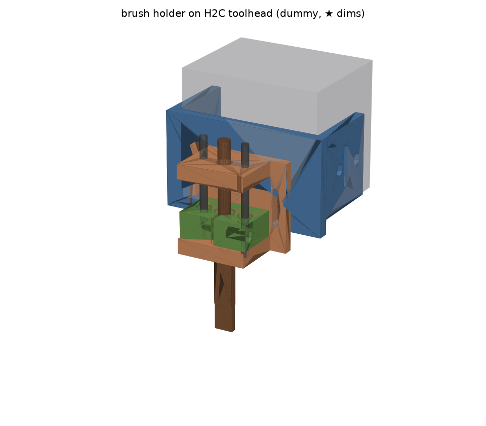
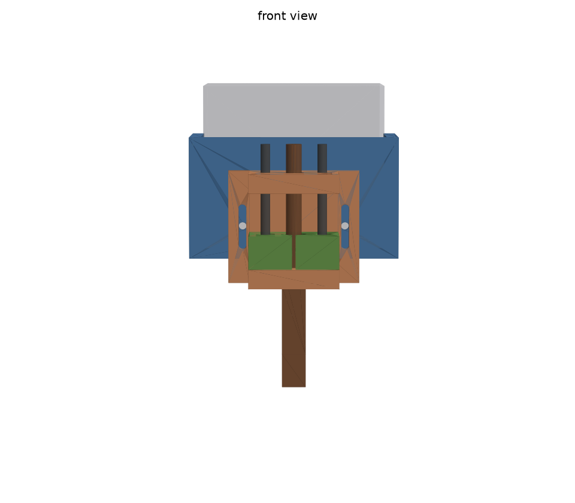
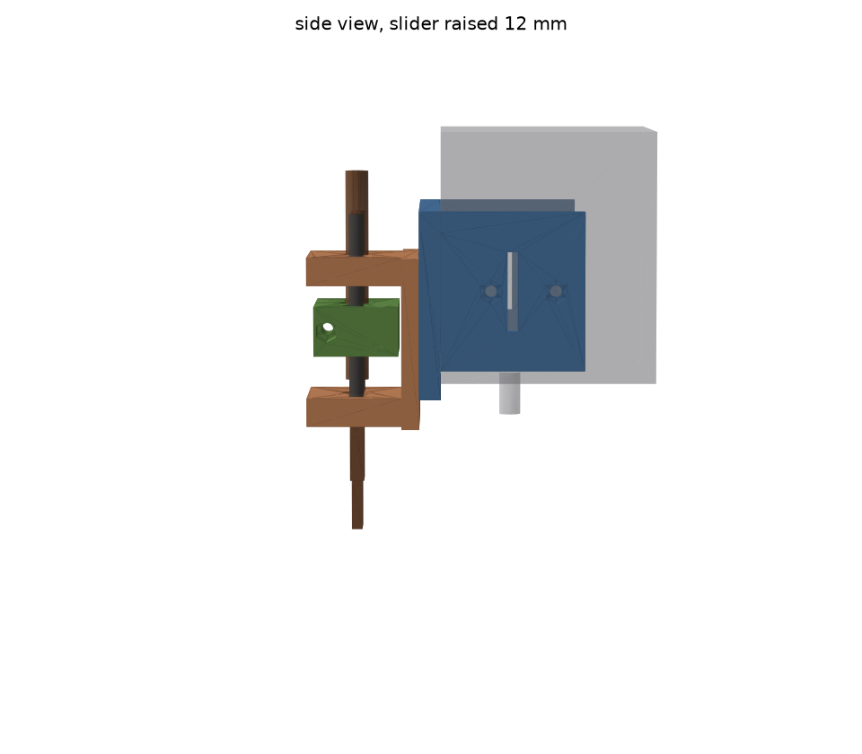
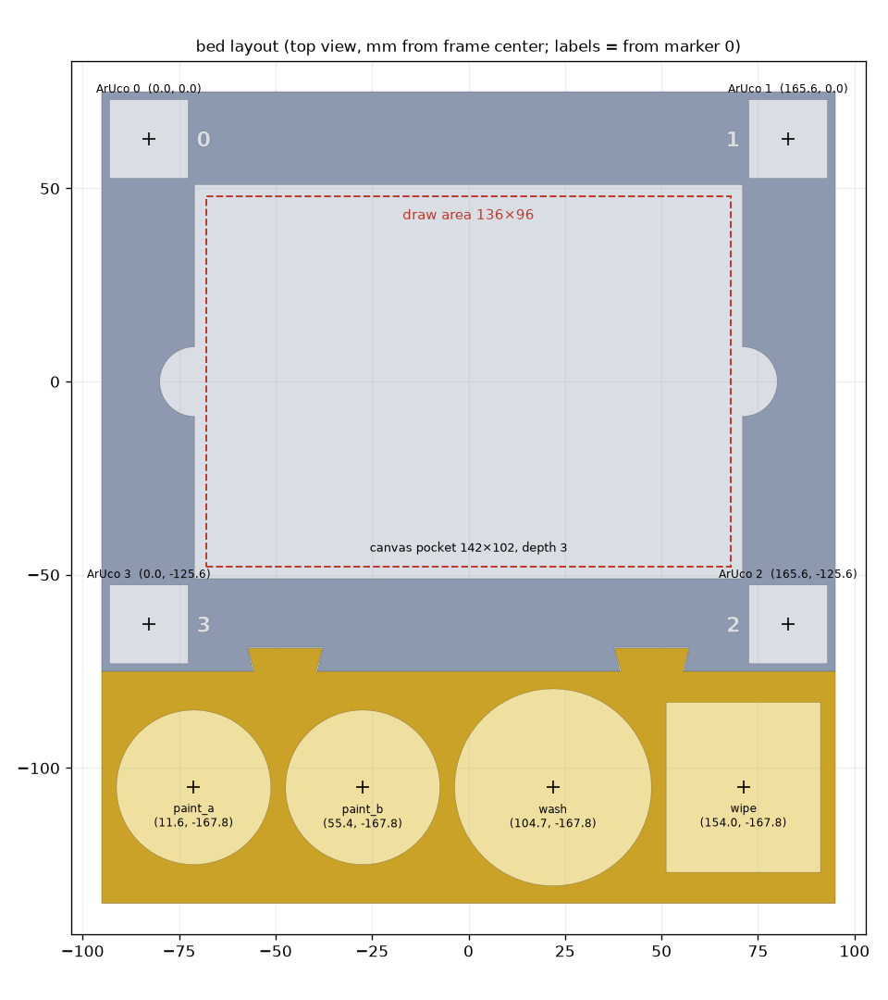

# 筆1本の試験装置（テストリグ）— 3D 部品

`docs/rig_plan.md` §3 の部品を Python（manifold3d）で作ったもの。対象は **Bambu Lab H2C**、筆は**平筆中 10mm（柄 Ø6.5）**。

```bash
uv pip install -e '.[cad]'
.venv/bin/python rig/cad/rig.py           # STL → rig/cad/out/、プレビュー → rig/cad/preview/、寸法チェック
.venv/bin/python rig/cad/rig.py --check   # チェックだけ（30 項目）
```

**版（バージョン）**: すべての印刷部品に `R<VERSION>`（今は **R1**）を刻んである。刻む場所は底面（鏡文字、裏返すと読める）で、底面に入らない部品は上向きの平らな面。部品の形を変えたら `rig.py` の `VERSION` を上げて出力し直す（`out/manifest.json` と比べて、上げ忘れるとテストが止まる）。刻印のない部品は最初の版 R0。

ArUco マーカーの印刷用画像は `.venv/bin/python rig/cad/markers.py` → `out/aruco_4x4_50_id0-3_20mm.png`（600dpi、100% で印刷）。

寸法はすべて `rig/cad/rig.py` 冒頭の定数。**★ の値は推定**（H2C のツールヘッド寸法は公開されていない）なので、
最初に `fit_test.stl` を印刷して実測し、定数を直してから本番の部品を出す。



| 正面 | 横（筆が 12mm 押し上げられたとき） |
| --- | --- |
|  |  |



## 部品（`rig/cad/out/*.stl`、印刷向きに配置済み）

| STL | 個数 | 内容 | 印刷 |
| --- | --- | --- | --- |
| `fit_test` | 1 | クランプの輪切り（高さ 8）＋穴のテスト片（S: シャフト 3.8/3.9/4.0、B: 軸受 7.95/8.05/8.15、H: 柄 6.6/6.8/7.0） | **最初に**。PLA で可 |
| `mount` | 1 | ツールヘッドを左右から挟む U 字クランプ。腕の M3 押しねじ ×4、面ファスナー用スロット、guide 用ナットトラップ ×2 | 前板を下。サポートなし |
| `guide` | 1 | 上下の耳（Ø4 シャフト圧入、柄の通し穴、上の耳の下面にばね座）＋背板（縦長穴で高さ ±8mm） | 背板を下。シャフト穴は横向きになるので、きつければ Ø4 ドリルでさらう |
| `slider` | 1 | LM4UU ×2 圧入、柄の割りクランプ（M3 で締める）、上面にばね座 | そのまま |
| `pad` | 2 | 押しねじの先に貼る当て板（ツールヘッドを傷付けない） | TPU 推奨 |
| `board_frame` | 1 | 枠 190×150×6。キャンバスのポケット 142×102×深さ 3、四隅に ArUco 20mm の窪み（深さ 0.6、ID 刻印）、前辺に蟻溝 ×2 | PETG 推奨 |
| `station_tray` | 1 | 190×60×4。絵の具皿 A・B（Ø40）、洗浄皿（Ø51）、拭き取り布（40×44）の位置決め。奥辺の蟻 ×2 を枠に上から差し込む | PETG 推奨（溶剤に PLA より強い） |

`rig_layout.json` は、ソフト側（予定の `configs/rig.yaml`）に渡す設計値。中身は次のとおり。

- 筆先のノズルからのずれ: `(0, -24, -45)` mm
- ストローク・予圧・高さ調整幅
- マーカー 0 の中心を基準にした、各マーカー・描画エリア・ステーションの位置（mm）

ジョグで実測するのはマーカー 0 の中心だけ（`docs/rig_plan.md` §3.2）。

## 買うもの（ねじは M3 のみ）

| 部品 | 数 | 用途 |
| --- | --- | --- |
| Ø4×60mm シャフト | 2 | 直動 |
| LM4UU（Ø4 / 外径 8 / 長さ 12） | 2 | スライダー |
| 圧縮ばね 外径 10・内径 8〜9・自由長 25・線径 0.5〜0.7 | 1〜2 | 筆圧。柄と同軸、予圧 4mm |
| M3×16 + ナット | 1 | 柄の割りクランプ |
| M3×12 + ナット | 4 | クランプの押しねじ（先に `pad`） |
| M3×10 + ナット | 2 | guide → mount |
| 面ファスナーのバンド 幅 20 | 1 | 予備の固定（腕のスロットに通してツールヘッドに一周） |
| 小さい陶器皿 Ø39 以下 ×2、低いガラス皿 Ø50・高さ 30 以下、布 | | ステーション |
| キャンバスボード（141×101 に切る、厚み 3 まで）か、キャンバス紙＋裏板 | | |
| マイクロスイッチ（任意、M2 取付・穴間隔 9.5） | 1 | キャンバス面の検出。上の耳の右前に下穴あり |

## 組み立て

1. `fit_test` を印刷して確認する。
   - 輪切りをツールヘッドに差し、左右の隙間と腕の届く奥行きを見る。合わなければ `TH_W` / `TH_D` / `TH_Z0` を直す。
   - 穴のテスト片で、シャフト・LM4UU・柄がちょうど入る径を選び、`SHAFT_FIT` / `LM_FIT` / `HANDLE_CLR` を直す。
2. `slider` に LM4UU を圧入する（緩ければ瞬間接着剤）。割りクランプの M3 ナットを入れておく。
3. `guide` の下の耳にシャフト 2 本を差し込み、`slider` → ばね → 上の耳の順に通す。
4. `mount` の前板の奥側（ツールヘッド側）のトラップに M3 ナット 2 個を入れ、`guide` を M3×10 で留める（高さは縦長穴で調整）。
5. 筆の柄を **約 100mm** に切り、下から下の耳 → スライダー → ばね → 上の耳の順に通す。
   割りクランプの中心から筆先まで **58mm**（`TIP_BELOW_CLAMP`）になる位置で締める。これで筆先はノズルより 45mm 下になる。
6. **ホーミングを済ませてから** `mount` をツールヘッドに被せ、`pad` を貼った押しねじで左右から軽く締める。

## H2C で使うときの注意

- 筆を付けたまま Z ホーミングすると筆がベッドに刺さる。筆はホーミングの後に付け、付けたらモーターを止めない。
- 筆はノズルより 24mm 手前にある。ベッドの手前端では、筆の届く範囲がノズルより 24mm 狭くなる。
- ヒーターは使わない（ノズル・ベッド・チャンバー）。ノズル交換ラックやカッターに行く動作が入らない G-code にする。
- H2C は Klipper / Marlin ではなく Bambu 独自のファームウェア。試し描きシートの G-code 出力（`docs/rig_plan.md` §4）は、H2C 向けの形式を別に用意する必要がある（未実装）。
- 洗浄皿の高さは 30mm 以下にする。筆先が皿の底にあるとき、ホルダーの最下面は皿の縁より 5mm 上にある（guide を一番下げた場合）。

## チェック内容（`--check`）

主なチェックは次のとおり（全 30 項目）。

- 筆先が洗浄皿の底まで下がっても、ホルダーが皿の縁に当たらない
- ばね: 予圧 4mm、12mm 押し上げても密着しない、外径がシャフトに当たらない
- 当たり判定: スライダー（静止時・12mm 上昇時）と耳、guide（±8mm）と mount、各部品とツールヘッドのダミー、筆と各部品
- ベッド側: 蟻と蟻溝、マーカーと描画エリア・ポケットの距離
- どの部品もベッドに収まり、形状が正常（閉じた立体）
